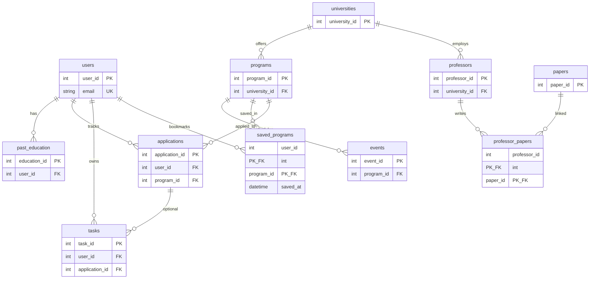

# Backend Wireframe and Models for Full Stack Web Development Project

**Course:** COMPE 561 — Full Stack Web Development

**Project:** GradVision

---

## 1. Project Overview

### Project title

**GradVision**

### Description

GradVision is a full-stack web application that helps prospective graduate students plan and manage their path to graduate school. The backend exposes a REST API (documented in `docs/GradVision_API.yaml`) that supports user accounts, discovery of universities and programs, exploration of faculty and research papers, and personal workflow tools such as saved programs, application tracking, tasks, and calendar deadlines. The data layer is modeled with SQLAlchemy ORM entities that mirror the API contract and Pydantic schemas used for request/response validation. This repository is the FastAPI backend for the COMPE 561 group project; the frontend consumes these endpoints to drive onboarding, exploration, and dashboard experiences.

### Main users and purpose

The primary users are **students and professionals applying to graduate programs** (master’s, PhD, or combined degrees). GradVision gives them one place to build a profile, search programs and professors aligned with their interests, bookmark promising programs, track application status and requirements, and stay on top of deadlines and to-do items.

### Main workflow

1. **Onboarding and profile** — Sign up, optionally add past education, then complete interests (research, career goals, program interests) and a personal statement on the “My Vision” profile.
2. **University and program discovery** — Browse universities, search and filter programs on the Explore page, and open full program detail (requirements, funding, events, links).
3. **Professor and paper exploration** — Search professors by university and research interests; view papers by professor or keyword/year (catalog data may be sourced from OpenAlex).
4. **Saved programs** — Save programs from Explore for later review.
5. **Application tracking** — Add programs to an application tracker, update status, check off requirement steps, and add notes.
6. **Dashboard tasks and calendar** — Manage a personal task list (optionally linked to an application) and view calendar events derived from program deadlines and related dates.

---

## 2. API Endpoint Overview

The API is specified in `docs/GradVision_API.yaml` (OpenAPI 3.0.3). Unless an endpoint sets `security: []`, it requires a **JWT bearer token** in the `Authorization` header (`bearerAuth`).

Common error body shape (`ErrorResponse`):

```json
{ "success": false, "error": "Human-readable message" }
```

Common success body for simple operations (`SuccessResponse`):

```json
{ "success": true }
```

---

### Auth

| Method | URL | Auth required | Purpose |
|--------|-----|---------------|---------|
| `POST` | `/api/auth/login` | No | Authenticate with email and password |
| `POST` | `/api/auth/logout` | Yes | Invalidate refresh token (logout) |
| `POST` | `/api/auth/refresh` | No | Obtain a new access token using a refresh token |

#### `POST /api/auth/login`

- **Request body:** `LoginRequest` — `email` (string, email), `password` (string), both required.
- **Success (200):** `TokenResponse` — `access_token`, `refresh_token`, `token_type` (e.g. `bearer`).
- **Errors:** `401` Unauthorized (invalid credentials); `422` ValidationError (missing/invalid input).

#### `POST /api/auth/logout`

- **Request body:** `RefreshRequest` — `refresh_token` (string), required.
- **Success (200):** `SuccessResponse`.
- **Errors:** `401` Unauthorized.

#### `POST /api/auth/refresh`

- **Request body:** `RefreshRequest` — `refresh_token` (string), required.
- **Success (200):** `{ "access_token": string, "token_type": "bearer" }`.
- **Errors:** `401` Unauthorized.

---

### Users

| Method | URL | Auth required | Purpose |
|--------|-----|---------------|---------|
| `POST` | `/api/users` | No | Register a new user (sign up) |
| `GET` | `/api/users/{id}` | Yes | Get user profile (My Vision) |
| `PATCH` | `/api/users/{id}` | Yes | Update profile (partial update) |
| `DELETE` | `/api/users/{id}` | Yes | Delete user account |

Path parameter: `id` (integer) — user ID.

#### `POST /api/users`

- **Request body:** `UserCreate` — required: `first_name`, `last_name`, `email`, `password`; optional: `past_education` (array of `PastEducationCreate` objects).
- **Success (201):** `{ "success": true, "user": User }` (password never returned).
- **Errors:** `400` BadRequest (e.g. email already in use); `422` ValidationError.

#### `GET /api/users/{id}`

- **Success (200):** `User` — profile fields including nested `past_education`, interest arrays, `personal_statement`, `created_at`, `updated_at`.
- **Errors:** `401` Unauthorized; `404` NotFound.

#### `PATCH /api/users/{id}`

- **Request body:** `UserUpdate` — all fields optional; send only fields to change (name, email, password, `past_education`, `research_interests`, `career_goals`, `program_interests`, `personal_statement`).
- **Success (200):** `SuccessResponse`.
- **Errors:** `401` Unauthorized; `403` Forbidden (not owner); `404` NotFound; `422` ValidationError.

#### `DELETE /api/users/{id}`

- **Success (200):** `SuccessResponse`.
- **Errors:** `401` Unauthorized; `403` Forbidden; `404` NotFound.

---

### Search

| Method | URL | Auth required | Purpose |
|--------|-----|---------------|---------|
| `GET` | `/api/search/` | Yes (default) | Search programs (Explore page) |
| `GET` | `/api/search/professors/` | Yes (default) | Search professors |

#### `GET /api/search/`

- **Query parameters (all optional):** `query` (string), `field` (string), `degree_type` (`Masters` \| `PhD` \| `Combined`), `location` (string), `funding_available` (boolean), `limit` (integer), `offset` (integer).
- **Success (200):** Array of `ProgramSearchResult` (program fields, nested university summary, optional `next_deadline`).

#### `GET /api/search/professors/`

- **Query parameters (optional):** `university` (string), `research_interests` (string).
- **Success (200):** Array of `Professor`.

---

### Universities and Programs

| Method | URL | Auth required | Purpose |
|--------|-----|---------------|---------|
| `GET` | `/api/universities/` | No | List universities (summary) |
| `GET` | `/api/program/{program_id}` | No | Full detail for one program |

#### `GET /api/universities/`

- **Query parameters (optional):** `location`, `search` (match university name), `program_fields` (array of strings, form style), `limit`, `offset`.
- **Success (200):** Array of `UniversitySummary` (`university_id`, `university_name`, `location`, `program_count`, `professor_count`).

#### `GET /api/program/{program_id}`

- **Path parameter:** `program_id` (integer), required.
- **Success (200):** `Program` (full detail including `events`, requirements, funding, etc.).
- **Errors:** `404` NotFound.

---

### Professors and Papers

| Method | URL | Auth required | Purpose |
|--------|-----|---------------|---------|
| `GET` | `/api/professors/{id}/papers` | No | Papers authored/linked to one professor |
| `GET` | `/api/papers` | No | Search papers (Research tab) |

#### `GET /api/professors/{id}/papers`

- **Path parameter:** `id` (integer) — professor ID.
- **Success (200):** Array of `Paper`.
- **Errors:** `404` NotFound.

#### `GET /api/papers`

- **Query parameters (optional):** `professor_id` (integer), `query` (keywords), `year_published` (integer).
- **Success (200):** Array of `Paper`.

---

### Saved Programs

| Method | URL | Auth required | Purpose |
|--------|-----|---------------|---------|
| `GET` | `/api/users/{id}/saved-programs/` | Yes | List saved programs |
| `POST` | `/api/users/{id}/saved-programs/` | Yes | Save a program |
| `DELETE` | `/api/users/{id}/saved-programs/{program_id}` | Yes | Remove a saved program |

Path parameters: `id` (user ID), `program_id` (integer) on delete.

#### `GET /api/users/{id}/saved-programs/`

- **Success (200):** Array of `ProgramSummary`.
- **Errors:** `401` Unauthorized.

#### `POST /api/users/{id}/saved-programs/`

- **Request body:** `ProgramIdRequest` — `program_id` (integer), required.
- **Success (201):** `SuccessResponse`.
- **Errors:** `401` Unauthorized; `404` NotFound (program or user).

#### `DELETE /api/users/{id}/saved-programs/{program_id}`

- **Success (200):** `SuccessResponse`.
- **Errors:** `401` Unauthorized; `404` NotFound.

---

### Applications

| Method | URL | Auth required | Purpose |
|--------|-----|---------------|---------|
| `GET` | `/api/users/{id}/applications/` | Yes | List applications (dashboard tracker) |
| `POST` | `/api/users/{id}/applications/` | Yes | Create application (“Add to Applications”) |
| `PATCH` | `/api/applications/{id}` | Yes | Update status or requirement checkboxes |
| `DELETE` | `/api/applications/{id}` | Yes | Remove application |

#### `GET /api/users/{id}/applications/`

- **Success (200):** Array of `Application` (includes joined `program_name`, `university_name` in the API contract).
- **Errors:** `401` Unauthorized.

#### `POST /api/users/{id}/applications/`

- **Request body:** `ProgramIdRequest` — `program_id` (integer), required.
- **Success (201):** `{ "success": true, "application": Application }`.
- **Errors:** `400` BadRequest (e.g. duplicate application); `401` Unauthorized; `404` NotFound.

#### `PATCH /api/applications/{id}`

- **Path parameter:** `id` — application ID.
- **Request body:** `ApplicationUpdate` — optional: `status`, `transcripts_done`, `recommendations_done`, `statement_done`, `test_scores_done`, `notes`.
- **Success (200):** `SuccessResponse`.
- **Errors:** `401` Unauthorized; `403` Forbidden; `404` NotFound.

#### `DELETE /api/applications/{id}`

- **Success (200):** `SuccessResponse`.
- **Errors:** `401` Unauthorized; `403` Forbidden; `404` NotFound.

---

### Tasks and Calendar

| Method | URL | Auth required | Purpose |
|--------|-----|---------------|---------|
| `GET` | `/api/users/{id}/calendar/` | Yes | Calendar deadlines and events |
| `GET` | `/api/users/{id}/tasks/` | Yes | List tasks |
| `POST` | `/api/users/{id}/tasks/` | Yes | Create a task |
| `PATCH` | `/api/tasks/{id}` | Yes | Update or complete a task |
| `DELETE` | `/api/tasks/{id}` | Yes | Delete a task |

#### `GET /api/users/{id}/calendar/`

- **Success (200):** Array of `CalendarEvent` (`event_id`, `program_id`, `label`, `event_type`, `event_date`).
- **Errors:** `401` Unauthorized.

#### `GET /api/users/{id}/tasks/`

- **Success (200):** Array of `Task`.
- **Errors:** `401` Unauthorized.

#### `POST /api/users/{id}/tasks/`

- **Request body:** `TaskCreate` — required: `title`; optional: `due_date` (date-time), `application_id` (integer, nullable).
- **Success (201):** `{ "success": true, "task": Task }`.
- **Errors:** `401` Unauthorized; `422` ValidationError.

#### `PATCH /api/tasks/{id}`

- **Request body:** `TaskUpdate` — optional: `title`, `due_date`, `completed`.
- **Success (200):** `SuccessResponse`.
- **Errors:** `401` Unauthorized; `404` NotFound.

#### `DELETE /api/tasks/{id}`

- **Success (200):** `SuccessResponse`.
- **Errors:** `401` Unauthorized; `404` NotFound.

---

## 3. Data Models

SQLAlchemy models live in `src/app/models/models.py`. Pydantic schemas in `src/app/schemas/` align with the OpenAPI components for API I/O.

### Enums

| Enum | Values | Used on |
|------|--------|---------|
| `DegreeType` | `Masters`, `PhD`, `Combined` | `Program.degree_type` |
| `ApplicationStatus` | `not started`, `in progress`, `submitted`, `accepted`, `rejected` | `Application.status` |

### User

| Field | Type | Constraints / defaults |
|-------|------|-------------------------|
| `user_id` | `int` | Primary key |
| `first_name` | `String(100)` | Required |
| `last_name` | `String(100)` | Required |
| `email` | `String(255)` | Required, unique, indexed |
| `hashed_password` | `String(255)` | Required (not exposed in API responses) |
| `research_interests` | `JSON` (list of strings) | Optional; default `list` |
| `career_goals` | `JSON` | Optional; default `list` |
| `program_interests` | `JSON` | Optional; default `list` |
| `personal_statement` | `Text` | Optional |
| `created_at` | `DateTime` | Server default `now()` |
| `updated_at` | `DateTime` | Server default `now()`, on update |

**Relationships:** `past_education`, `applications`, `tasks`, `saved_programs` — all cascade delete with the user (`ondelete="CASCADE"` on child FKs).

### PastEducation

| Field | Type | Constraints / defaults |
|-------|------|-------------------------|
| `education_id` | `int` | Primary key |
| `user_id` | `int` | FK → `users.user_id`, `ON DELETE CASCADE` |
| `university_name` | `String(255)` | Required (free text, not FK to catalog) |
| `major` | `String(255)` | Optional |
| `degree` | `String(50)` | Required |
| `year_started` | `Integer` | Required |
| `year_ended` | `Integer` | Required |
| `currently_attending` | `Boolean` | Default `False` |
| `updated_at` | `DateTime` | Server default / on update |

**Relationship:** `user` → `User`.

### University

| Field | Type | Constraints / defaults |
|-------|------|-------------------------|
| `university_id` | `int` | Primary key |
| `university_name` | `String(255)` | Required, indexed |
| `location` | `String(255)` | Optional |

**Relationships:** `programs`, `professors` (catalog; no cascade delete from university by default).

### Program

| Field | Type | Constraints / defaults |
|-------|------|-------------------------|
| `program_id` | `int` | Primary key |
| `university_id` | `int` | FK → `universities.university_id` |
| `program_name` | `String(255)` | Required |
| `degree_type` | `Enum(DegreeType)` | Required |
| `field` | `String(255)` | Optional |
| `funding_available` | `Boolean` | Default `False` |
| `application_requirements` | `JSON` (list) | Default `list` |
| `application_link` | `String(500)` | Optional |
| `program_start` | `Integer` | Optional (e.g. year) |
| `program_end` | `Integer` | Optional |
| `program_content` | `JSON` (list) | Default `list` |
| `price` | `Integer` | Optional |

**Relationships:** `university`, `events`, `saved_by` (`SavedProgram`), `applications`.

### Event

| Field | Type | Constraints / defaults |
|-------|------|-------------------------|
| `event_id` | `int` | Primary key |
| `program_id` | `int` | FK → `programs.program_id` |
| `label` | `String(255)` | Required |
| `event_type` | `String(100)` | Required (e.g. `deadline`) |
| `event_date` | `Date` | Required |

**Relationship:** `program` → `Program`. Exposed via API as `CalendarEvent`.

### Professor

| Field | Type | Constraints / defaults |
|-------|------|-------------------------|
| `professor_id` | `int` | Primary key |
| `university_id` | `int` | FK → `universities.university_id` |
| `name` | `String(255)` | Required |
| `department` | `String(255)` | Optional |
| `research_interests` | `JSON` (list) | Default `list` |

**Relationships:** `university`, `papers` (via `ProfessorPaper` association objects).

### Paper

| Field | Type | Constraints / defaults |
|-------|------|-------------------------|
| `paper_id` | `int` | Primary key |
| `title` | `String(500)` | Required |
| `authors` | `JSON` (list) | Default `list` |
| `topics` | `JSON` (list) | Default `list` |
| `abstract` | `Text` | Optional |
| `publication_date` | `Date` | Optional |
| `external_id_openalex` | `String(100)` | Optional, indexed |
| `link` | `String(500)` | Optional |

**Relationship:** `professors` (via `ProfessorPaper`). API `Paper` schema also includes `professor_ids`, assembled from join rows in the service layer.

### ProfessorPaper

Association **object** (not a bare secondary table) for Professor ↔ Paper many-to-many.

| Field | Type | Constraints |
|-------|------|-------------|
| `professor_id` | `int` | PK (composite), FK → `professors.professor_id` |
| `paper_id` | `int` | PK (composite), FK → `papers.paper_id` |

**Relationships:** `professor`, `paper`.

### SavedProgram

Association object for User ↔ Program bookmarks.

| Field | Type | Constraints / defaults |
|-------|------|-------------------------|
| `user_id` | `int` | PK (composite), FK → `users.user_id`, `ON DELETE CASCADE` |
| `program_id` | `int` | PK (composite), FK → `programs.program_id` |
| `saved_at` | `DateTime` | Server default `now()` |

**Relationships:** `user`, `program`.

### Application

| Field | Type | Constraints / defaults |
|-------|------|-------------------------|
| `application_id` | `int` | Primary key |
| `user_id` | `int` | FK → `users.user_id`, `ON DELETE CASCADE` |
| `program_id` | `int` | FK → `programs.program_id` |
| `status` | `Enum(ApplicationStatus)` | Default `not started` |
| `transcripts_done` | `Boolean` | Default `False` |
| `recommendations_done` | `Boolean` | Default `False` |
| `statement_done` | `Boolean` | Default `False` |
| `test_scores_done` | `Boolean` | Default `False` |
| `notes` | `Text` | Optional |
| `created_at` | `DateTime` | Server default |
| `updated_at` | `DateTime` | Server default / on update |

**Relationships:** `user`, `program`, `tasks` (cascade delete with application).

### Task

| Field | Type | Constraints / defaults |
|-------|------|-------------------------|
| `task_id` | `int` | Primary key |
| `user_id` | `int` | FK → `users.user_id`, `ON DELETE CASCADE` |
| `application_id` | `int` | Optional, FK → `applications.application_id`, `ON DELETE CASCADE` |
| `title` | `String(500)` | Required |
| `due_date` | `DateTime` | Optional |
| `completed` | `Boolean` | Default `False` |

**Relationships:** `user`, optional `application`.

---

## 4. Database Schema

### Tables and foreign keys

| Table | Primary key | Foreign keys |
|-------|-------------|--------------|
| `users` | `user_id` | — |
| `past_education` | `education_id` | `user_id` → `users` (CASCADE) |
| `universities` | `university_id` | — |
| `programs` | `program_id` | `university_id` → `universities` |
| `events` | `event_id` | `program_id` → `programs` |
| `professors` | `professor_id` | `university_id` → `universities` |
| `papers` | `paper_id` | — |
| `professor_papers` | (`professor_id`, `paper_id`) | → `professors`, `papers` |
| `saved_programs` | (`user_id`, `program_id`) | → `users` (CASCADE), `programs` |
| `applications` | `application_id` | `user_id` → `users` (CASCADE), `program_id` → `programs` |
| `tasks` | `task_id` | `user_id` → `users` (CASCADE), `application_id` → `applications` (CASCADE, nullable) |

### Cascade policy (from model design)

- **User-owned data** (`past_education`, `applications`, `tasks`, `saved_programs`): deleting a user removes their rows.
- **Catalog data** (`programs`, `professors`, `events`, `professor_papers`): foreign keys use default **RESTRICT** (no `ondelete CASCADE` on catalog parents) so removing a university does not silently delete programs still referenced by applications.

### Many-to-many relationships

**SavedProgram (User ↔ Program)**

- Each row is one bookmark: composite primary key `(user_id, program_id)`.
- A user can save many programs; a program can be saved by many users.
- Extra column `saved_at` records when the save happened.
- Implemented as a mapped class so future columns (e.g. notes on a save) can be added without changing the pattern.

**ProfessorPaper (Professor ↔ Paper)**

- Each row links one professor to one paper: composite primary key `(professor_id, paper_id)`.
- Professors can have many papers; papers can be linked to many professors (co-authorship / affiliation).
- Same association-object pattern as `SavedProgram` for direct queries and future metadata.

### Entity-relationship diagram



---

## 5. Authentication

**Status: specified in OpenAPI and Pydantic schemas; not yet implemented in route handlers.**

The planned flow uses **JWT bearer authentication** (`components.securitySchemes.bearerAuth`):

1. **Sign up** — `POST /api/users` (public) creates a user; passwords are stored only as **hashed** values in `users.hashed_password` (hashing algorithm and salting to be implemented in the auth service layer, e.g. bcrypt or passlib).
2. **Login** — `POST /api/auth/login` validates email/password and returns **`access_token`** and **`refresh_token`** (`TokenResponse`).
3. **Access token** — Short-lived (OpenAPI comments suggest ~30 minutes). Sent as `Authorization: Bearer <access_token>` on protected routes.
4. **Refresh token** — Longer-lived; stored and validated server-side for `POST /api/auth/refresh` (public) to mint a new access token without re-entering credentials.
5. **Logout** — `POST /api/auth/logout` invalidates the refresh token (implementation detail: blocklist, DB store, or rotation strategy).
6. **Protected routes** — Default API security requires a valid access token. Endpoints marked `security: []` are public (login, refresh, sign up, some catalog reads).

Ownership checks (e.g. user `{id}` in path must match the authenticated user) will yield **403 Forbidden** per the OpenAPI contract.

---

## 6. Middleware and Configuration

### Database session handling (implemented)

`src/app/core/database.py` provides:

- **`DATABASE_URL`** — from environment variable `DATABASE_URL`, default `sqlite:///./gradvision.db`.
- **`engine`** — SQLAlchemy engine; SQLite uses `check_same_thread=False`.
- **`SessionLocal`** — session factory (`autocommit=False`, `autoflush=False`).
- **`get_db()`** — FastAPI dependency that yields a session and closes it after the request.

ORM models inherit from **`Base`** (`DeclarativeBase`).

### Environment variables (planned / partial)

| Variable | Role |
|----------|------|
| `DATABASE_URL` | Database connection string (SQLite locally; PostgreSQL in production per comments in `database.py`) |
| JWT secrets, token TTLs, CORS origins | **Planned** — not yet defined in code |

### CORS (planned)

The frontend will run on a separate origin during development. **CORS middleware** (e.g. `CORSMiddleware` in FastAPI) should allow configured origins, methods, and headers once routers are wired. Not present in `main.py` today.

### Logging (planned)

Structured or standard logging for request errors, auth failures, and database errors should be added as routes are implemented. Not configured in the current minimal `main.py`.

---

## 7. Error Handling

Responses follow the OpenAPI `ErrorResponse` pattern unless a successful schema is defined.

| HTTP status | Meaning | Typical cases |
|-------------|---------|----------------|
| **400** Bad Request | Business rule violation | Duplicate email on sign up; duplicate application for same program |
| **401** Unauthorized | Missing or invalid auth | No bearer token; expired/invalid JWT; wrong login credentials |
| **403** Forbidden | Authenticated but not allowed | Accessing or modifying another user’s profile, applications, saved programs, or tasks |
| **404** Not Found | Resource missing | Unknown `user_id`, `program_id`, `application_id`, `task_id`, or professor |
| **422** Validation Error | Request body/query fails validation | Pydantic/FastAPI validation (missing required fields, wrong types, invalid email) |

**Validation errors:** Handled by FastAPI/Pydantic for request bodies and query parameters; should map to `422` with a clear `error` message in the unified format where possible.

**Ownership checks:** For routes under `/api/users/{id}/...`, the authenticated user ID must match `{id}` (or an admin role if added later); otherwise return **403**.

---

## 8. Testing Plan

### FastAPI Swagger UI

Once routers are mounted and match `docs/GradVision_API.yaml`, use **Swagger UI** at `/docs` (or import the YAML) to manually exercise endpoints: public catalog reads, sign up, login, authorized calls with bearer token, and error cases (404, 401).

### pytest

Add **`pytest`** with **`httpx`** / **`TestClient`** for automated API tests:

- **Auth:** login success/failure; refresh with valid/invalid token; protected route without token → 401.
- **Users:** create user; get/update/delete own profile; 403 when touching another user’s ID.
- **Search and catalog:** filter programs; list universities; get program by ID; 404 for missing program.
- **Saved programs:** POST save, GET list, DELETE unsave; idempotent behavior and 404 edge cases.
- **Applications:** create, list, PATCH status and checklist fields, DELETE; 400 on duplicate.
- **Tasks and calendar:** CRUD tasks; optional `application_id`; calendar returns events for user’s context.

### Database tests

Use a **test database** (e.g. in-memory SQLite) with fixtures that create `SessionLocal` per test, roll back transactions, or recreate schema from `Base.metadata.create_all`.

### What exists today

No test suite is in the repository yet; this section describes the **intended** coverage as implementation proceeds.

---

## 9. Current Implementation Status

| Area | Status |
|------|--------|
| OpenAPI contract (`docs/GradVision_API.yaml`) | **Exists** — full endpoint and schema specification |
| SQLAlchemy models (`src/app/models/models.py`) | **Exists** — all entities and relationships defined |
| Pydantic schemas (`src/app/schemas/`) | **Exists** — auth, users, past education, universities, programs, papers, applications/tasks |
| Database setup (`src/app/core/database.py`) | **Exists** — engine, session, `get_db` dependency |
| FastAPI app (`src/app/main.py`) | **Minimal** — only `GET /` hello endpoint; **no API routes from the YAML are wired yet** |
| Routers / route handlers | **Not implemented** |
| CRUD / repository layer | **Not implemented** |
| JWT authentication and password hashing | **Not implemented** (schemas and OpenAPI only) |
| Migrations / DB initialization (`create_all`, Alembic, seed data) | **Not implemented** |
| CORS, logging, production config | **Not implemented** |
| Automated tests | **Not implemented** |

**Summary:** The **models**, **schemas**, **database session setup**, and **OpenAPI contract** form the backend wireframe and data design for GradVision. **Most routers, business logic, authentication, database initialization, seed data, and tests remain to be built** so that the running server behavior matches the documented API. Until that work is complete, endpoints described in this document should be treated as the **target design**, not as currently functional HTTP routes (except the placeholder root endpoint).
